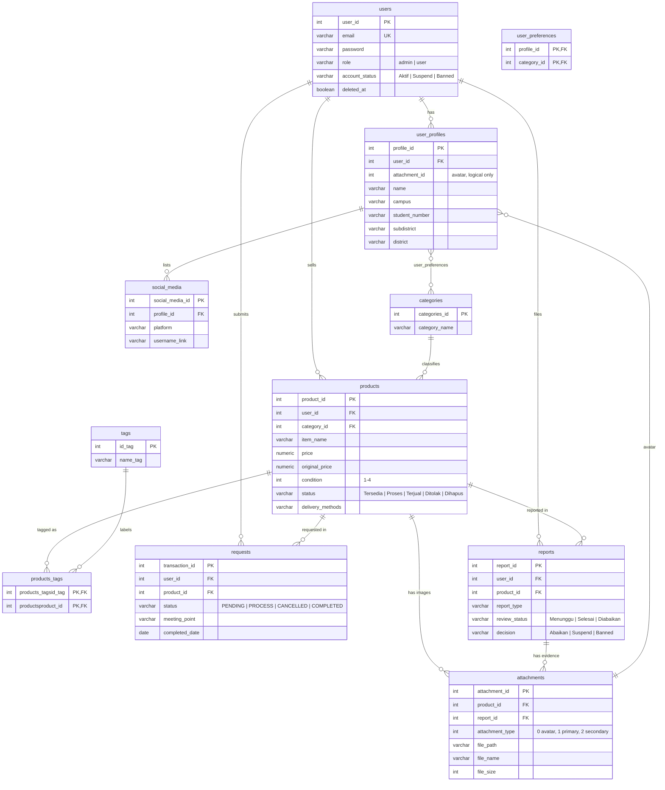

# Pasar Kampus

A local E-Commerce App to help college student in particular to sell, search, and buy a prelove item.

## Admin dashboard database setup

## Database structure

PostgreSQL, 11 tables in the `public` schema. Schema, seed data and stored procedures live in `database/` (`schema.sql`, `seed.sql`, `procedure.sql`). Every table carries `created_at` / `updated_at` timestamps defaulting to `CURRENT_TIMESTAMP`.

### Tables

| Table | Purpose | Notes |
| --- | --- | --- |
| `users` | Account and access record | `email` unique; `role` drives admin access; `account_status` drives sanctions; `deleted_at` is a boolean soft-delete flag (NULL or FALSE = active) |
| `user_profiles` | Public seller/buyer profile | One row per user in practice; `attachment_id` points at the avatar attachment without a database FK |
| `social_media` | Profile links | `platform` + `username_link`, cascade-deleted with the profile |
| `categories` | Product categories | Referenced by products (`RESTRICT`) and user preferences (`CASCADE`) |
| `user_preferences` | Category interests per profile | Composite PK `(profile_id, category_id)`, the many-to-many join for the recommendation feed |
| `tags` | Free-form product labels | Referenced only through `products_tags` |
| `products` | Listed item | `condition` 1–4; `price`/`original_price` are `NUMERIC(19,0)`; `status` tracks the listing lifecycle |
| `products_tags` | Product ↔ tag join | Composite PK `(products_tagsid_tag, productsproduct_id)` |
| `requests` | Purchase / COD request against a product | PK column is `transaction_id`; `meeting_point` is the agreed COD location; `completed_date` set on completion |
| `reports` | Product or user report | `review_status` is the moderation queue; `decision` records the sanction applied |
| `attachments` | Uploaded files | `attachment_type` 0 = profile avatar, 1 = product primary image, 2 = product secondary image; `product_id` / `report_id` are nullable so one table serves all three owners |

### Relationships

- `users` is the root: `products`, `requests`, `reports` and `user_profiles` all cascade on user deletion.
- `products` belongs to one `users` row (seller) and one `categories` row; deleting a category is blocked while products reference it.
- `requests` and `reports` each reference a `products` row; deleting a product cascades both.
- `products_tags` is the product ↔ tag join and cascades from either side.
- `attachments` hangs off `products` and `reports` with `ON DELETE SET NULL`, so a deleted product or report keeps the file row but loses its owner link.
- `user_profiles.attachment_id` → `attachments.attachment_id` is enforced by application code only; there is no FK constraint on that column.

### Stored procedures (`database/procedure.sql`)

| Procedure | Effect |
| --- | --- |
| `acc_transaction(request_id, product_id)` | Sets the accepted request to `PROCESS` and cancels every other request for the same product |
| `finish_transaction(request_id, product_id)` | Sets the request to `COMPLETED` with `completed_date = CURRENT_DATE` and marks the product sold |
| `cancel_transaction(request_id, product_id)` | Sets the request to `CANCELLED` and returns the product to the sellable state |

### Known drift

- The live `products_status_check` accepts `Tersedia`, `Proses`, `Terjual`, `Ditolak`, `Dihapus`, but `schema.sql`, `seed.sql` and `procedure.sql` still use the older `ONSELL` / `SOLD` vocabulary. Running `finish_transaction` or `cancel_transaction` against the current database violates that constraint.
- `schema.sql` opens with MySQL statements (`DROP DATABASE` / `CREATE DATABASE` / `USE`), so it cannot be executed verbatim on the PostgreSQL container.
- `attachments` carries a self-referencing constraint (`attachment_id` → `attachments.attachment_id`); it is a no-op for the profile-avatar relation it was meant to express.
